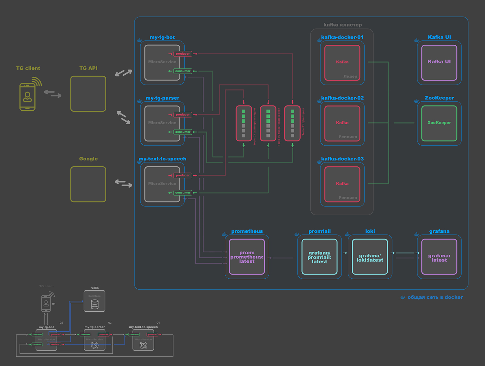

# TolkoTalk: Микросервисное приложение для Telegram и синтеза речи

! *приложение в процессе разработки

## Архитектура

TolkoTalk — это распределённое приложение, состоящее из трёх микросервисов, взаимодействующих между собой через Kafka:

- **tg_bot_micserv** — Telegram-бот для взаимодействия с пользователем.
- **tg_app_micserv** — сервис для получения и парсинга сообщений из Telegram-каналов.
- **text_to_speech_micserv** — сервис синтеза речи с интеграцией внешних API (Google, PlayHT, Gemini).

Вся коммуникация между сервисами осуществляется асинхронно через Kafka-топики.

---

## Схема приложения



---

## Описание микросервисов

### 1. tg_bot_micserv
- Запускает Telegram-бота.
- Принимает команды и сообщения от пользователя.
- Позволяет выбирать канал, скорость речи, период времени, отправлять запросы на синтез.
- Отправляет запросы в Kafka (топик `tgbot-tgapp`, `texttospeech-tgbot`).
- Получает готовое аудио и отправляет его пользователю в Telegram.
- Использует PostgreSQL для хранения избранных каналов и истории запросов.

### 2. tg_app_micserv
- Авторизуется в Telegram через Telegram API.
- Получает сообщения из выбранных каналов.
- Парсит и форматирует текст для дальнейшего синтеза.
- Формирует структуру данных и отправляет её в Kafka (топик `tgapp-texttospeech`).
- Получает аудиофайлы из Kafka (топик `tgapp-tgbot`) и отправляет их в tg_bot_micserv.

### 3. text_to_speech_micserv
- Получает текстовые запросы из Kafka (топик `tgapp-texttospeech`).
- Синтезирует речь с помощью внешних API:
  - **Google Text-to-Speech** (требуется credentials JSON).
  - **PlayHT** (требуются PLAYHT_USER_ID и PLAYHT_SECRET_KEY).
  - **Gemini** (требуется GEMENI_GOOGLE_API_KEY).
- Возвращает аудиофайлы в Kafka (топик `texttospeech-tgbot`).
- Поддерживает масштабирование и мониторинг (Prometheus).

---

## Взаимодействие микросервисов (Kafka)

- **tgbot-tgapp**: tg_bot_micserv → tg_app_micserv (запросы пользователя).
- **tgapp-texttospeech**: tg_app_micserv → text_to_speech_micserv (текст для синтеза).
- **texttospeech-tgbot**: text_to_speech_micserv → tg_bot_micserv (готовое аудио).
- **tgapp-tgbot**: для обратной передачи аудио tg_app_micserv.

---

## Интеграции с внешними API

### Telegram API (tg_app_micserv)
- Для работы с Telegram API необходима регистрация приложения на https://my.telegram.org.
- Требуются параметры:
    - `TELEGRAM_API_ID` — ID приложения Telegram (получается после регистрации).
    - `TELEGRAM_API_HASH` — Hash приложения Telegram (получается после регистрации).
    - `PHONE` — номер телефона Telegram-аккаунта (в международном формате).
    - `TELEGRAM_PASSWORD` — пароль двухфакторной аутентификации (если включён).
- Все параметры указываются в .env микросервиса tg_app_micserv.

### Google Text-to-Speech
- Необходим файл credentials JSON (GOOGLE_CREDENTIALS_FILE).
- Переменная окружения: `GOOGLE_CREDENTIALS_FILE`.

### PlayHT
- Необходимы ключи пользователя и секрет: `PLAYHT_USER_ID`, `PLAYHT_SECRET_KEY`.

### Gemini
- Необходим API-ключ: `GEMENI_GOOGLE_API_KEY`.

Все ключи и файлы указываются в .env соответствующего микросервиса.

---

## Переменные окружения (пример)

### text_to_speech_micserv/.env
```
SERVER_PORT=5003
GOOGLE_CREDENTIALS_FILE="/app/credentials.json"
GEMENI_GOOGLE_API_KEY="..."
PLAYHT_USER_ID="..."
PLAYHT_SECRET_KEY="..."
KAFKA_PORT_01="localhost:9095"
KAFKA_PORT_02="localhost:9096"
KAFKA_PORT_03="localhost:9097"
NAME_TOPIC_01="tgapp-texttospeech"
NAME_TOPIC_02="texttospeech-tgbot"
KAFKA_GROUP_ID="text-to-speech-group"
```

### tg_app_micserv/.env
```
TELEGRAM_API_ID=...
TELEGRAM_API_HASH=...
PHONE=...
TELEGRAM_PASSWORD=...
SERVER_PORT=5002
KAFKA_PORT_01="localhost:9095"
KAFKA_PORT_02="localhost:9096"
KAFKA_PORT_03="localhost:9097"
KAFKA_TOPIC_01="tgbot-tgapp"
KAFKA_TOPIC_02="tgapp-texttospeech"
KAFKA_TOPIC_03="tgapp-tgbot"
WORKER_POOL_SIZE="20"
```

### tg_bot_micserv/.env
```
TG_BOT_TOKEN=...
SERVER_PORT=:5001
KAFKA_PORT_01=kafka-1:9092
KAFKA_PORT_02=kafka-2:9092
KAFKA_PORT_03=kafka-3:9092
NAME_TOPIC_01=tgbot-tgapp
NAME_TOPIC_02=texttospeech-tgbot
NAME_TOPIC_03=tgapp-texttospeech
NAME_TOPIC_04=tgapp-tgbot
DB_HOST=localhost
DB_PORT=5432
POSTGRES_DB_NAME=tg-bot-db
POSTGRES_USER=tg-bot-user
POSTGRES_PASSWORD=...
DB_SSL_MODE=disable
```

---

## Пошаговый сценарий работы приложения

1. Пользователь взаимодействует с Telegram-ботом (tg_bot_micserv): выбирает канал, период, скорость речи, отправляет запрос.
2. tg_bot_micserv отправляет запрос в Kafka (tgbot-tgapp).
3. tg_app_micserv получает запрос, авторизуется в Telegram, парсит сообщения из выбранного канала, очищает текст.
4. tg_app_micserv отправляет подготовленный текст в Kafka (tgapp-texttospeech).
5. text_to_speech_micserv получает текст, синтезирует речь через выбранный внешний API (Google, PlayHT, Gemini).
6. text_to_speech_micserv отправляет аудиофайл в Kafka (texttospeech-tgbot).
7. tg_bot_micserv получает аудиофайл и отправляет его пользователю в Telegram.

---

## Требования к окружению
- Go 1.22+
- Docker (опционально)
- Kafka (3 брокера)
- PostgreSQL (для tg_bot_micserv)
- Внешние API-ключи и credentials (Google, PlayHT, Gemini)

---

## Запуск

### Локально
1. Клонируйте репозиторий и перейдите в нужный сервис.
2. Создайте .env с нужными переменными.
3. Установите зависимости:
   ```bash
   go mod tidy
   ```
4. Запустите сервис:
   ```bash
   go run cmd/main.go
   ```

### Docker
1. Соберите образ:
   ```bash
   docker build -t <имя_сервиса> .
   ```
2. Запустите контейнер:
   ```bash
   docker run -p <порт>:<порт> --env-file .env <имя_сервиса>
   ```

---

## Пример сценария работы пользователя
1. Пользователь пишет боту в Telegram.
2. Выбирает канал, период, скорость речи.
3. Получает аудиофайл с синтезированной речью из сообщений выбранного канала.

---

## Структура проекта (фрагмент)
```
/tg_bot_micserv
/tg_app_micserv
/text_to_speech_micserv
```

---

## Мониторинг и логирование
- Все сервисы используют slog для логирования.
- Метрики Prometheus реализованы в каждом сервисе.

---

## Лицензия